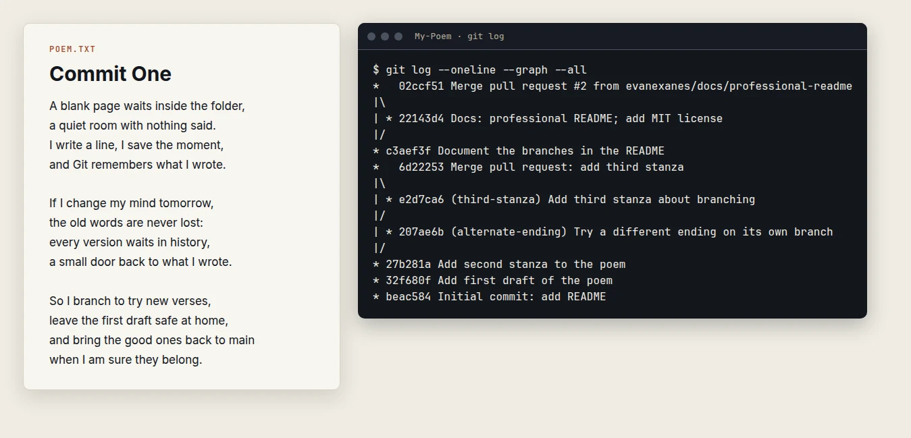

<div align="center">

# My-Poem

**My first Git and GitHub repository: a short poem about version control, kept as a branching exercise.**


[](LICENSE)



<sub>The poem and the branching history it was written to practise.</sub>

</div>

## What this shows
- A first Git and GitHub exercise where the history matters more than the poem.
- It holds a merged pull request (the third stanza) and a branch left unmerged on purpose (the alternate ending).
- Run `git log --oneline --graph --all` after cloning to see the branches.

## About
I made this for MOBPROG (IT-252) while following "1.1: Introduction - Git and GitHub for Poets" by The Coding Train. The poem is in [`poem.txt`](poem.txt). What matters here is the history: commits, branches and a pull request.

## Branches

| Branch | What it holds |
|---|---|
| `main` | The poem as published |
| `third-stanza` | A third stanza, merged through a pull request |
| `alternate-ending` | A different ending, left unmerged on purpose |

## Try it
```bash
git clone https://github.com/evanexanes/My-Poem.git
cd My-Poem
git log --oneline --graph --all
```

## License
The poem is released under the [MIT License](LICENSE).

## Author
**Evan Prens P. Exanes** · [GitHub](https://github.com/evanexanes) · [Portfolio](https://evanexanes.github.io/) · [Contact](https://evanexanes.github.io/07-contact.html)
